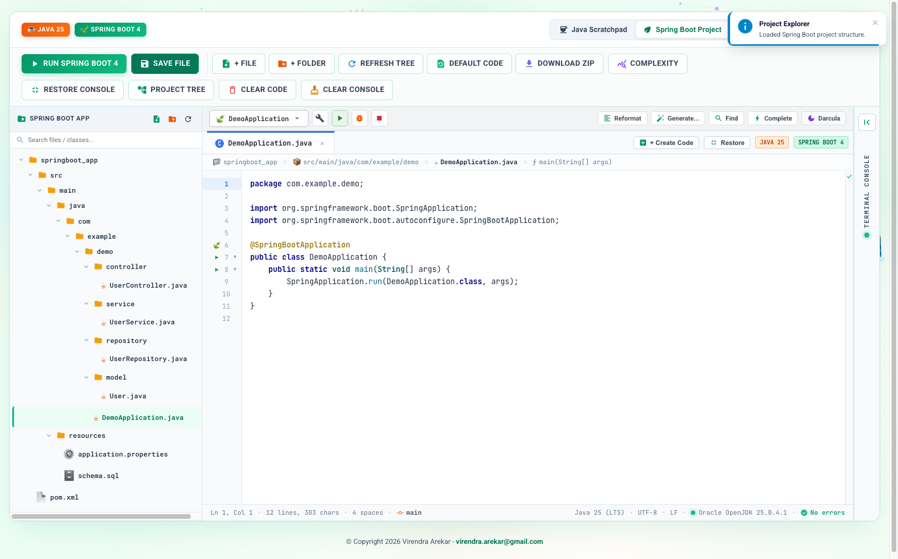

# ☕ Java 25 (LTS) & 🍃 Spring Boot 4 Interactive Runner
### Standalone Development Studio & Project Directory Explorer with Multi-Database Inspector

A high-performance backend runner, project directory explorer, and multi-database inspection studio designed for modern **Java 25 (Oracle LTS)** and **Spring Boot 4.0** developers.



---

## 🌟 Key Capabilities & Upgrades

### 1. 📁 Full Control Over Spring Boot Project Directory Structure (`springboot_app/`)
- **Interactive Project Explorer Tree**: Full recursive directory explorer displaying the standard Spring Boot architecture:
  - 📁 `src/main/java/com/example/demo/`
    - 📁 `controller/`: REST API Controllers (e.g., `UserController.java`)
    - 📁 `service/`: Service Layer & Business Logic (`UserService.java`)
    - 📁 `repository/`: Spring Data JPA Repositories (`UserRepository.java`)
    - 📁 `model/`: JPA Entities & Domain Models (`User.java`)
    - 📄 `DemoApplication.java`: Main Spring Boot application entrypoint
  - 📁 `src/main/resources/`
    - 📄 `application.properties`: Datasource, JPA, and Virtual Threads configuration
    - 📄 `schema.sql`: Initial DDL & DML migration scripts
  - 📄 `pom.xml`: Complete Maven POM configured for Java 25 & Spring Boot 4
- **Create Files Anywhere (`+ File`)**: Interactive dialog allowing you to pick any target folder, name the file, and select starter templates (Spring REST Controller, Service, JPA Entity, Repository, application.properties, schema.sql, or Blank).
- **Create Directories Anywhere (`+ Folder`)**: Add custom packages such as `dto`, `config`, `security`, `exception`, etc.
- **Click-to-Open & Save**: Seamlessly browse files with automatic breadcrumbs, tab tracking, and instant disk persistence (`POST /api/boot/file`).

### 2. 🖥️ Maximized Code Creation Area & Minimizable Console Area
- **Spacious Code Editor**: The code area is maximized by default to provide an expansive workspace for designing Spring Boot 4 components, controllers, services, and domain models.
- **`+ Create Code` Quick Action**: Direct button right in the editor tab bar (`+ Create Code`) allowing instant creation and scaffolding of new Spring Boot files anywhere in the project tree.
- **One-Click Console Minimization**:
  - Click **`Maximize Code Area`** (in top ribbon or tab bar) or **`Minimize Console (🗕)`** to collapse the right console into a sleek 44px vertical docking rail (`TERMINAL CONSOLE`).
  - Expanding gives the editor and project tree 100% of the screen width minus the slim 44px rail.
  - Click the vertical rail or **`Restore Console`** at any time to reopen the console.
- **Auto-Expansion on Execution**: When you click **`Run Spring Boot 4`** or **`Run Java 25`** (or press `Cmd/Ctrl + Enter`), the console automatically expands to reveal live compilation output, Tomcat port status, and execution metrics.

### 3. 🎨 Colorful VS Code Syntax Highlighting
- **Synchronized Stack**: A high-performance two-layer stack with a synchronized `<pre><code>` highlight layer underneath and a transparent, high-responsiveness `<textarea>` capturing cursor and keystrokes.
- **VS Code Theme Tokens**:
  - 🟣 **Annotations**: `@SpringBootApplication`, `@RestController`, `@Service`, `@Repository`, `@Entity`, `@Table`, `@GetMapping`, `@PostMapping`, `@Id`, `@Autowired`
  - 🔵 **Keywords & Declarations**: `public`, `private`, `class`, `interface`, `record`, `extends`, `implements`, `package`, `import`, `return`, `void`, `new`, `var`
  - 🟢 **Strings**: Clean emerald green syntax tokens (`"..."`, `"""..."""`)
  - 🟠 **Numbers**: Amber/orange literal values (`42`, `100L`, `1.23`)
  - 🩵 **Types & Classes**: Teal/dark cyan (`String`, `Long`, `ResponseEntity`, `Instant`, `List`, `Optional`)
  - 🌸 **Control Flow**: Bold rose/magenta (`if`, `else`, `for`, `while`, `switch`, `try`, `catch`)
  - 🗄️ **SQL & MQL**: Blue SQL keywords (`SELECT`, `INSERT`, `UPDATE`, `DELETE`, `FROM`, `WHERE`) and Mongo collection methods.
- **Active Line Number Gutter**: Line numbers dynamically update with cursor position tracking.

### 3. 🌿 Light Nature Background & Floating Tech Emblems
- **Light Spring Boot Palette**: Soft mint, emerald ice, and warm ivory backgrounds (`#f0fdf4`, `#ecfdf5`, `#ffffff`), with Spring green accents (`#10b981`, `#059669`) and warm Java coffee accents (`#ea580c`, `#c2410c`).
- **Living HTML5 Canvas Animation**:
  - ☕ **Java Coffee Cup**: Detailed silhouette with saucer, handle, and gently wafting rising steam ribbons.
  - 🍃 **Spring Boot Leaf**: Emerald/mint leaf silhouette with iconic diagonal split vein.
  - 🛡️ **Hibernate Shield**: Golden/amber ORM shield with stylized central 'H'.
  - 🏛️ **JPA (Java Persistence API)**: Architectural database cylinder pedestal with golden ribbon and "JPA" badge.
  - 🌌 **Constellation Network**: Ambient connecting particles drifting softly across the light canvas.

### 4. 🗄️ Multi-Database Inspector with Live CRUD & Manual Connection Editing
- **Instant Engine Toggles**:
  - 🐬 **MySQL 8.4 / 9.0 Enterprise** (Default Port: `3306`)
  - 🐘 **PostgreSQL 17.2 Hyperscale** (Default Port: `5432`)
  - 🏢 **Microsoft SQL Server 2025** (Default Port: `1433`)
  - 🍃 **MongoDB 8.0 Atlas Cluster** (Default Port: `27017`)
- **Manual Connection Configuration**:
  - Click **`Edit Connection`** to customize Host, Port, Database, User, Password, and URI string.
  - Click **`Test Connection`** to ping the endpoint and inspect real-time latency.
- **Table Data CRUD Operations**:
  - **Edit Record (✏️)**: Modify row values inline with dynamic type preservation.
  - **Add Record (➕)**: Insert custom records into any active table or collection.
  - **Delete Record (🗑️)**: Remove records with instant confirmation.
  - **View Modes**: Switch between interactive Tabular Grid and raw JSON/BSON document view.

### 5. ⚡ Real Java 25 & Spring Boot 4 Execution Engine
- **Oracle JDK 25 LTS**: Compiles and executes modern Java with Virtual Threads (`Thread.ofVirtual`), pattern matching, records, and preview features.
- **Spring Boot 4 Runtime Simulator**: Renders authentic Spring Boot ASCII banner, Tomcat port initialization, HikariCP pool logs, and mapped REST endpoints.
- **Algorithmic Complexity Analyzer**: Evaluates Big-O time and space complexity with live badge and explanation banner.
- **Zero UI Review Pane**: 100% focused on backend architecture, service controllers, and database inspection.

---

## 🚀 Quickstart Guide

Inside the `jdk/` directory, start the standalone server:

```bash
cd /Users/apple/Desktop/Practice/Javascript/jdk
node server.js
```

Open your browser and navigate to:
👉 **`http://localhost:8080`**

---

## ⌨️ Keyboard Shortcuts
- **`Ctrl + Enter` / `Cmd + Enter`**: Run active Spring Boot app, Java code, or DB query
- **`Ctrl + S` / `Cmd + S`**: Save active file to disk
- **`Tab`**: Smart 4-space code indentation

---

## 📁 Project Structure

```
jdk/
├── favicon.svg               # Java Cup & Spring Boot dual SVG favicon
├── index.html                # Main Workbench UI (Tree Explorer, VS Code Editor, DB Inspector)
├── package.json              # Standalone manifest
├── README.md                 # Complete documentation
├── screenshot.png            # Studio Workbench preview screenshot
├── script.js                 # Interactive engine, file tree explorer, living canvas, VS Code highlighter
├── server.js                 # Node.js backend: REST APIs for tree, files, compilation, and DB CRUD
├── style.css                 # Light Spring Boot theme, colorful syntax highlighting & micro-interactions
└── springboot_app/           # Live Spring Boot 4 & Java 25 application directory
    ├── pom.xml
    └── src/
        ├── main/
        │   ├── java/com/example/demo/
        │   │   ├── controller/UserController.java
        │   │   ├── service/UserService.java
        │   │   ├── repository/UserRepository.java
        │   │   ├── model/User.java
        │   │   └── DemoApplication.java
        │   └── resources/
        │       ├── application.properties
        │       └── schema.sql
        └── test/
```

---

## 📜 Copyright
&copy; Copyright 2026 **Virendra Arekar** - [virendra.arekar@gmail.com](mailto:virendra.arekar@gmail.com)
